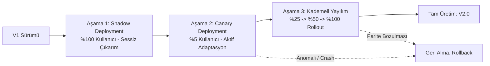

# The Primer v2.0 Dağıtım ve Sürüm Stratejisi (RELEASE.md)

Bu doküman, **The Primer v1** (kural ve LLM tabanlı kriz simülasyonu) sürümünden **The Primer v2.0** (istemci taraflı ONNX Makine Öğrenmesi adaptasyonlu akıllı eğitim sistemi) sürümüne geçişin mimari kararlarını, dağıtım stratejilerini ve operasyonel risk yönetimini belgeler.

---

## 1. v1 $\to$ v2 Değişiklik Özeti (Changelog)

| Bileşen | The Primer v1 | The Primer v2.0 |
| :--- | :--- | :--- |
| **Öğrenci Desteği** | Yalnızca kullanıcı butona basınca açılan reaktif AI Tutor (Gemini API). | Davranışsal makine öğrenmesi modeliyle (ONNX DecisionTree) proaktif tetiklenen Socratic ipucu paneli ($P \ge 0.50$). |
| **Çıkarım Mimarisi** | Yok (Sadece harici bulut LLM API çağrısı). | Tarayıcı içi yerel WebAssembly çıkarımı (`onnxruntime-web`), sıfır ağ gecikmesi, %100 çevrimdışı çalışma. |
| **Telemetri & Veri** | Sadece oturum içi geçici React state'i. | Anonim veri toplama motoru (`SessionDecisionRecord`), KVKK/GDPR uyumlu, PII içermeyen yerel CSV dışa aktarımı. |
| **Model Artefaktları** | Yok. | `model/model.onnx`, `model/config.json`, Hugging Face Hub sürümleme altyapısı (`v2.0`). |
| **Test & Doğrulama** | Fonksiyonel Cypress E2E testleri. | Python (`tests/parite.py`) ile Tarayıcı (`05_model_parity.cy.ts`) arasında $10^{-4}$ toleranslı parite testleri ve adaptasyon senaryoları (`06_model_adaptation.cy.ts`). |

---

## 2. Dağıtım Stratejileri

Canlı üretim ortamında (Production) makine öğrenmesi modellerinin kullanıcı deneyimini bozmaması ve olası sürüklenme (drift) veya performans anomalilerinin önlenmesi için kademeli bir dağıtım stratejisi tasarlanmıştır.

### 2.1. Gölge Dağıtım (Shadow Deployment) — 1. Hafta
- **Mekanizma:** ONNX modeli tarayıcıda arka planda tüm oturumlar için (`%100`) çalıştırılır; ancak UI'da proaktif banner gösterilmez (sessiz mod).
- **Amaç:** WebAssembly yükleme süreleri, tarayıcı uyumluluğu, bellek tüketimi ve Python-WASM paritesi canlı üretim koşullarında risk oluşturmadan ölçülür.
- **Başarı Kriteri:** Çıkarım hatası $< \%0.01$, tarayıcı çökmesi $\%0$.

### 2.2. Kanarya Dağıtımı (Canary Deployment) — 2. Hafta (%5)
- **Mekanizma:** Oturum kimliğinin (`sessionId`) hash değerine göre kullanıcıların rastgele `%5`'ine model adaptasyonu aktif edilir.
- **Gözlem Metrikleri:**
  - Simülasyonu tamamlama oranı (v1 ile fark $\pm \%5$ aralığında olmalı).
  - Kullanıcı başına karar süresi ve yanlış karar oranları.
  - Socratic ipucu panelinin kapatılma (dismiss) veya tıklanma oranı.

### 2.3. Aşamalı Yayılım (Progressive Rollout) — 3. ve 4. Hafta
- **Aşama A (%25):** Canary metrikleri doğrulandıktan sonra dağıtım oranı artırılır.
- **Aşama B (%50):** A/B testi formatında destek alan ve almayan grupların öğrenme verimliliği karşılaştırılır.
- **Aşama C (%100):** Tüm kullanıcılara tam sürüm sunulur.

---

## 3. Geri Alma (Rollback) ve Hata Toleransı Stratejisi

Modelin çalışmasında veya tarayıcı ortamında herhangi bir aksaklık yaşanması durumunda sistem aşağıdaki önlemleri otomatik olarak devreye alır:

1. **WASM Başarısızlığı / Aygıt Desteği Yok:**
   - Eğer `onnxruntime-web` WASM modülü tarayıcı kısıtlamaları (örn. CSP, eski Safari, bellek limiti) nedeniyle yüklenemezse, `onnxInference.ts` içindeki `fallbackRuleBasedInference()` fonksiyonu şeffaf olarak devreye girer:
     $$P_{\text{destek}} = \min(1.0, 0.2 \times \text{hata} + 0.1 \times \text{ipucu} + (\text{sure} > 25 ? 0.3 : 0.0))$$
   - Kullanıcıya hiçbir kesinti yansıtılmaz; UI'da model durum rozeti `Yedek Kural (WASM Hatası)` olarak etiketlenir.
2. **Kritik UI Regresyonu Durumunda:**
   - Feature-flag (`VITE_ENABLE_ML_ADAPTATION=false`) ortam değişkeni kapatılarak uygulama tek bir git revert gerekmeksizin doğrudan **The Primer v1** saf kural tabanlı moduna döndürülebilir.

---

## 4. Mimari Karşılaştırma Matrisi (Trade-Off Matrix)

The Primer projesinde neden **Tarayıcı İçi Çıkarım (Browser / ONNX WebAssembly)** seçildiğini gösteren kapsamlı mimari değerlendirme matrisi:

| Değerlendirme Kriteri | Tarayıcı İçi (ONNX WASM) *(Seçilen Mimari)* | Uç Cihaz / Mobil (Native ONNX) | Sunucu Tarafı (FastAPI / Triton Server) |
| :--- | :--- | :--- | :--- |
| **Gecikme (Latency)** | **< 2 ms** (Yerel bellek içi doğrudan hesaplama, sıfır ağ turu). | **< 1 ms** (Doğrudan C++ / CoreML / NNAPI donanım hızlandırma). | **80 – 350 ms** (HTTP/HTTPS ağ gecikmesi, kuyruk ve TLS el sıkışması). |
| **Gizlilik & KVKK** | **Üstün.** Kullanıcının tereddütleri ve karar süreleri cihazdan asla çıkmaz. | **Üstün.** Veri cihazda kalır. | **Riskli.** Her ham etkileşim ve davranış verisi sunucuya iletilmek zorundadır. |
| **Çevrimdışı Çalışabilirlik** | **Tam (%100).** PWA veya statik dağıtımla internet olmadan çalışır. | **Tam (%100).** | **Sıfır.** İnternet kesilirse model tahmin üretemez. |
| **Sunucu Maliyeti** | **0 TL.** Milyonlarca kullanıcı olsa dahi sunucu CPU/GPU maliyeti oluşmaz. | **0 TL.** | **Yüksek.** Eşzamanlı kullanıcı sayısıyla paralel büyüyen sunucu/GPU gideri. |
| **Model Fikri Mülkiyet (IP) Koruması** | **Düşük / Orta.** ONNX modeli tarayıcı Network sekmesinden indirilebilir (Açık kaynak projeler için ideal). | **Orta / Yüksek.** Binary içine gömülebilir veya şifrelenebilir. | **Üstün.** Model sunucuda gizlidir; kullanıcı yalnızca API çıktısını görür. |
| **Donanım / Kaynak Yükü** | Kullanıcı tarayıcısına ~10 MB WASM/model bellek yükü (Tabular model için ihmal edilebilir). | Cihaz pili ve depolama alanı. | Tüm hesaplama yükü sunucu cluster'ındadır. |
| **Kurulum & Erişim Kolaylığı** | **Tek Tıkla Web.** Kullanıcının hiçbir uygulama yüklemesi gerekmez. | App Store / Play Store onay süreci ve indirme zorunluluğu. | Web istemci gerektirir. |

### Sonuç ve Mimari Gerekçe:
The Primer bir web tabanlı simülasyon projesidir. Geliştirilen model 6 özellikli tabular bir Karar Ağacı (Decision Tree) olduğundan dosya boyutu yalnızca **~8 KB**'tır. Bu boyut için sunucu altyapısı kurmak gereksiz gecikme, KVKK riskleri ve sunucu maliyeti yaratacaktır. Bu nedenle **Tarayıcı İçi Çıkarım (ONNX WebAssembly)** gecikme, gizlilik, maliyet ve çevrimdışı çalışma açısından en optimum mimaridir.

