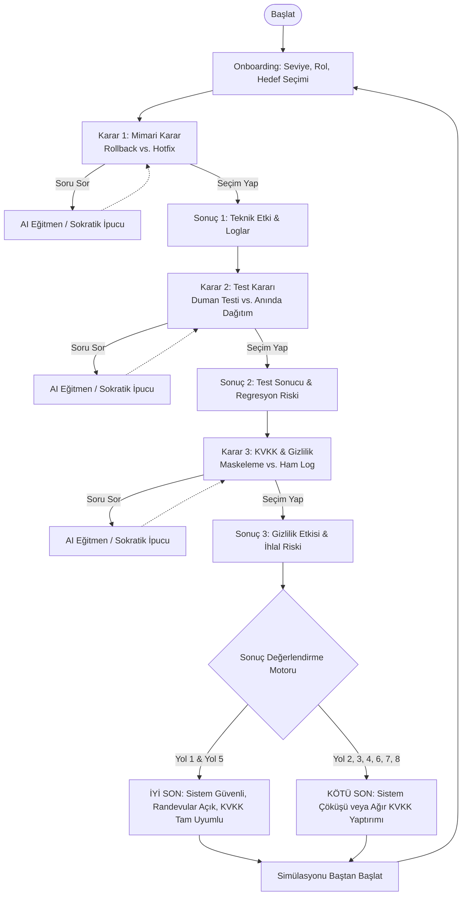

# SE PRIMER — Sistem ve Yazılım Mühendisliği Kriz Simülasyonu
## Kapsamlı Ürün ve Teknik Şartname Belgesi (spec.md)

**Versiyon:** 1.0.0  
**Tarih:** 2026-10-30  
**Durum:** Onaylandı / Uygulamaya Hazır  
**Dil:** Türkçe (Turkish)  

---

## 1. Problem Tanımı (Problem Statement)
Geleneksel yazılım mühendisliği eğitimi; teori, sentetik kodlama ödevleri ve izole algoritmik problemler üzerine odaklanmaktadır. Ancak gerçek dünyada yazılım mühendisleri, yüksek baskı altında, belirsiz kriz anlarında ve teknik ödünleşimlerin (trade-offs) kaçınılmaz olduğu durumlarda karar vermek zorundadır. 

Özellikle kritik sağlık sistemlerinde (ör. hastane randevu sistemleri) yapılan mimari hatalar, yetersiz test adımları veya Kişisel Verilerin Korunması Kanunu (KVKK) ihlalleri yalnızca sistem kesintisine değil; yüzlerce hastanın sağlık hizmetine erişememesine, operasyonel çöküşe ve ağır hukuki yaptırımlara neden olabilmektedir.

Mevcut öğrenme araçları:
1. Öğrenciye gerçekçi üretim (production) kriz hissini ve sorumluluğunu yaşatmamaktadır.
2. AI asistanları genellikle cevabı doğrudan vererek (answer giveaway) öğrencinin bilişsel muhakeme sürecini baltalamaktadır.
3. Öğrencinin kıdemine (beginner/intermediate/experienced) veya uzmanlık rolüne göre kişiselleştirilmiş bir kriz senaryosu sunmamaktadır.

## 2. Hedef Kitle (Target Users)
- **Bilgisayar ve Yazılım Mühendisliği Öğrencileri:** Dağıtık sistemler, DevOps, test mühendisliği ve KVKK gereksinimlerini pratik bir kriz ortamında deneyimlemek isteyenler.
- **Junior & Mid-Level Yazılım Geliştiriciler:** Nöbetçi mühendis (On-call Engineer) rolüne hazırlanan, kriz anında geri alma (rollback) vs. acil yama (hotfix) karar mekanizmalarını öğrenmek isteyen mühendisler.
- **Teknik Liderler ve Eğitmenler:** Mühendis adaylarının kriz anındaki karar verme reflekslerini, teknik gerekçelendirmelerini ve etik/hukuki farkındalıklarını ölçmek isteyen kurumlar.

## 3. Ürün Amacı (Product Objective)
**SE Primer**, kullanıcıyı saat 08:00'de 300 hastanın sırada beklediği çökmüş bir sağlık randevu sisteminin **nöbetçi yazılım mühendisi (On-Call Engineer)** koltuğuna oturtan, mobil öncelikli (mobile-first), dallanan senaryolu (branching narrative) ve Sokratik yapay zekâ eğitmeni (AI Tutor) ile güçlendirilmiş interaktif bir mühendislik simülasyonudur.

Sistem, kullanıcının kararlarının anlık teknik ve hukuki sonuçlarını gösterir, seçimleri deterministik bir durum makinesinde işler ve kullanıcıyı iki kesin sondan (Başarılı Kriz Çözümü / Sistem veya KVKK Felaketi) birine ulaştırır.

---

## 4. Fonksiyonel Gereksinimler (Functional Requirements)

### FR-1: Onboarding ve Profilleme
- **FR-1.1:** Kullanıcıya zorunlu 3 soru sorulmalıdır:
  1. *Deneyim Seviyesi:* Başlangıç (Beginner), Orta (Intermediate), Deneyimli (Experienced).
  2. *Mühendislik Rolü:* Backend Developer, Frontend Developer, Full-Stack Developer, DevOps Engineer, Software Engineer, Öğrenci.
  3. *Öğrenme Hedefi:* Yazılım Mimarisi, Test ve Güvenilirlik, Güvenlik ve KVKK, Genel Yazılım Mühendisliği Becerileri.
- **FR-1.2:** Yanıtlar istemci tarafı durumunda (client-side state) saklanmalıdır. Kullanıcı adı, şifre veya kayıt/giriş işlemi gerektirmemelidir.

### FR-2: Kişiselleştirme Motoru (Personalization Engine)
- **FR-2.1 (Beginner):** Teknik terimler sade Türkçe açıklamalarla desteklenmeli, her kararda yönlendirici ipucu kutusu görünmeli, karardan sonra detaylı teknik bağlam sunulmalıdır.
- **FR-2.2 (Intermediate):** Kararlar arasındaki mimari ve operasyonel ödünleşimler (trade-offs) vurgulanmalı, orta düzey ipuçları sağlanmalıdır.
- **FR-2.3 (Experienced):** Her karar aşamasında 60 saniyelik geri sayım sayacı (countdown timer) çalışmalıdır. İleri seviye mühendislik terminolojisi kullanılmalı, asla doğru cevap ima edilmemeli, süre dolduğunda riskli varsayılan eylem tetiklenmelidir.
- **FR-2.4 (Rol ve Hedef):** Senaryo metinleri ve Sokratik eğitmen diyalogları seçilen role (ör. DevOps için CI/CD pipeline ve container sağlığı, Backend için veritabanı bağlantı havuzu ve migration) göre uyarlanmalıdır.

### FR-3: Kriz Senaryosu ve 3 Aşamalı Karar Mekanizması
- **FR-3.1:** Senaryo başlığı: *"08:00 — Randevu Sistemi Çöktü. Nöbetçi Sensin."*
- **FR-3.2:** Tam olarak 3 karar aşaması bulunmalıdır:
  - **Aşama 1 (Mimari Karar):** 
    - *Seçenek A (Rollback):* Önceki stabil sürüme geri alma (Veritabanı migration uyumluluğu, şema geri dönülebilirliği değerlendirilir).
    - *Seçenek B (Hotfix):* Doğrudan canlı ortamda (production) yama uygulama (Canlıda bilinmeyen yan etkiler, kod incelemesiz dağıtım riski).
  - **Aşama 2 (Test Kararı):** 
    - *Seçenek A (Kritik Yol / Duman Testi):* 5-10 dakikalık temel randevu akışı ve duman testlerini çalıştırma.
    - *Seçenek B (Anında Canlıya Dağıtım):* Testleri atlayıp sistemi hemen ayağa kaldırmak için doğrudan dağıtma.
  - **Aşama 3 (KVKK ve Veri Gizliliği Kararı):** 
    - *Seçenek A (Verileri Maskeleme):* Loglardaki hasta T.C. Kimlik No, ad-soyad, poliklinik ve tanı bilgilerini anonimleştirerek/maskeleyerek paylaşma.
    - *Seçenek B (Ham Logları Paylaşma):* Aciliyet gerekçesiyle logları doğrudan ve sansürsüz ortak kanala (Slack/Teams) atma.
- **FR-3.3 (Teknik Sonuç Kartı):** Her karardan sonra; ne olduğu, neden olduğu ve sistem metriği etkisi (servis durumu, hata oranı, veri güvenliği) gösterilmelidir.

### FR-4: Sokratik AI Eğitmen (AI Tutor)
- **FR-4.1:** Google Gemini API entegrasyonu ile Sokratik eğitim modeli uygulanmalıdır.
- **FR-4.2 (Kesin Kural - Sıfır Cevap Sızıntısı):** AI Eğitmen asla *"A seçeneğini seç"*, *"Geri almak doğru cevaptır"* gibi doğrudan yönlendirme yapamaz.
- **FR-4.3:** Öğrenciye soruyla karşılık vererek düşünmeye teşvik etmelidir (Ör: *"Geri almadan önce veritabanında şema değişikliği yapılıp yapılmadığını nasıl doğrularsın?"*).
- **FR-4.4 (Kişiselleştirilmiş İstem):** Kullanıcının deneyim seviyesine, rolüne ve mevcut aşamasına uygun Türkçe yanıt üretmelidir.
- **FR-4.5 (Çevrimdışı Güvenli Yedek - Fallback Engine):** Gemini API anahtarı girilmediğinde, kota dolduğunda veya ağ hatasında sistem kesintiye uğramamalı; her aşama ve seviye için önceden doğrulanmış Sokratik yanıtlar sunmalıdır.

### FR-5: İki Belirgin Son (Branching Endings)
- **FR-5.1:** Karar kombinasyonları (2 × 2 × 2 = 8 farklı yol) deterministik bir motorla değerlendirilir.
- **FR-5.2 (İYİ SON - Good Ending):** Sistem başarıyla ayağa kaldırıldı, hasta verileri KVKK'ya uygun korundu, 300 hasta güvenle randevusunu aldı. Detaylı çözüm zaman çizelgesi (08:25 itibariyle tam operasyonel durum) ve kazanılan mühendislik dersleri özetlenir.
- **FR-5.3 (KÖTÜ SON - Bad Ending):** Sistem açılsa dahi KVKK ihlali nedeniyle soruşturma açılması veya canlıya kontrolsüz dağıtımla veritabanı veri kaybı yaşanması gibi felaketler belgelenir. Yapılan kritik mühendislik hataları açıkça listelenir.
- **FR-5.4:** Simülasyonu sıfırlayıp farklı seçimlerle baştan başlatma (Restart) butonu sağlanmalıdır.

---

## 5. Fonksiyonel Olmayan Gereksinimler (Non-Functional Requirements)
- **NFR-1 (Mobil Öncelikli Tasarım):** Arayüz öncelikle 360px - 430px genişlikteki modern akıllı telefon ekranlarına göre optimize edilmeli, masaüstünde ise şık bir cihaz kabuğunda (device frame container) ortalanmalıdır.
- **NFR-2 (Görsel Kalite ve Tipografi):** Koyu lacivert/gece mavisi zemin (`#0a0f1d`), yüksek kontrastlı metinler, modern kart yapıları, profesyonel durum rozetleri ve akıcı geçiş animasyonları kullanılmalıdır. Generic okul projesi görünümünden kaçınılmalıdır.
- **NFR-3 (Performans):** Sayfa yüklenme süresi 1.5 saniyenin altında olmalı, karar geçişleri anlık gerçekleşmeli, AI yanıtları akıcı yükleme animasyonuyla gösterilmelidir.
- **NFR-4 (Güvenlik ve Gizlilik):** Gerçek hasta verisi kesinlikle kullanılmamalıdır. API anahtarları istemci tarafında hardcode edilmemeli; `.env` ve ortam değişkenleri mimarisi kurulmalı, repo gizliliği garanti edilmelidir.
- **NFR-5 (Erişilebilirlik ve Doğrulanabilirlik):** Tüm etkileşimli bileşenlerde Cypress testleri için kararlı `data-testid` öznitelikleri bulunmalıdır.

---

## 6. Kapsam Dahilindeki Özellikler (In-Scope Features)
1. 3 soruluk Onboarding akışı ve durum yönetimi.
2. 3 aşamalı, sağlık odaklı kriz simülasyon senaryosu.
3. Seviye bazlı kişiselleştirme (Beginner ipuçları, Experienced 60 saniyelik geri sayım sayacı).
4. Sokratik Gemini AI Eğitmen ve robust kural tabanlı çevrimdışı yedekleme (offline fallback).
5. 8 karar kombinasyonunu destekleyen deterministik durum makinesi.
6. Ayrıntılı kriz sonu raporlaması (İyi Son ve Kötü Son).
7. 20 öğrenci yanıtını içeren nesnel AI Eğitmen değerlendirme sistemi ve metrik raporu.
8. Tüm 8 yolu ve uç durumları doğrulayan Cypress E2E test paketi.
9. 60 saniyelik Türkçe anlatımlı demo senaryosu ve storyboard.

---

## 7. Kapsam Dışı Bırakılan Özellikler (Explicit Out-of-Scope Features)
Proje takvimi, akademik yönerge ve mimari kararlılık gereği aşağıdaki üç özellik **bilinçli olarak kapsam dışı bırakılmıştır**:

1. **Kullanıcı Kayıt ve Giriş Sistemi (User Authentication / Accounts):**
   *Gerekçe:* Öğrencinin simülasyona anında, sürtünmesiz erişebilmesi ve oturum yönetimi/veritabanı bağımlılığı olmadan yerel durum ile çalışabilmesi için kapsam dışı bırakılmıştır.
2. **Yerel Mobil Uygulama (Native iOS/Android App):**
   *Gerekçe:* Tarayıcı üzerinden evrensel erişilebilirlik sağlamak ve platform onay süreçlerinden kaçınmak amacıyla PWA standartlarında mobil öncelikli web uygulaması tercih edilmiştir.
3. **İkinci Bölüm / İkinci Senaryo (Second Simulation Chapter):**
   *Gerekçe:* Projenin tek bir kriz anındaki karar derinliğine, Sokratik pedagojiye ve test kapsamına odaklanmasını sağlamak amacıyla tek bölümlü tutulmuştur.

---

## 8. Kullanıcı Akışı (User Flow)
```
[Giriş / Karşılama]
       ↓
[Onboarding: 3 Profil Sorusu (Seviye, Rol, Hedef)]
       ↓
[Kriz Başlangıcı: 08:00 — Randevu Sistemi Çöktü (300 Hasta Sırada)]
       ↓
[Aşama 1: Mimari Karar (Rollback vs. Hotfix)]
       ├── (Opsiyonel: Sokratik AI Eğitmen ile Soru-Cevap)
       ├── (Experienced ise: 60s Sayaç)
       └── Seçim Yapılır → [Aşama 1 Teknik Sonuç Kartı]
       ↓
[Aşama 2: Test Kararı (Duman Testi vs. Anında Dağıtım)]
       ├── (Opsiyonel: Sokratik AI Eğitmen ile Soru-Cevap)
       └── Seçim Yapılır → [Aşama 2 Teknik Sonuç Kartı]
       ↓
[Aşama 3: KVKK & Gizlilik Kararı (Maskeleme vs. Ham Log)]
       ├── (Opsiyonel: Sokratik AI Eğitmen ile Soru-Cevap)
       └── Seçim Yapılır → [Aşama 3 Teknik Sonuç Kartı]
       ↓
[Sonuç Değerlendirme Algoritması (State Engine Evaluation)]
       ├── Tüm Kritik Kriterler Sağlandı → [İYİ SON: Sistem Güvenli, Veri Korundu]
       └── Kritik Hata / KVKK İhlali Var → [KÖTÜ SON: İhlal / Felaket Raporu]
       ↓
[Yeniden Başlat (Restart Simulation)]
```

---

## 9. Senaryo ve Karar Mantığı (Scenario & Decision Logic)

### Aşama 1: Mimari Karar (Architecture Decision)
- **Bağlam:** Gece 02:00'de dağıtılan v2.4.0 güncellemesi sonrası veritabanı bağlantı havuzu tükenmiş ve randevu mikroservisi HTTP 500 hataları üretmeye başlamıştır. 300 hasta poliklinik girişlerinde beklemektedir.
- **Seçenek A — Önceki Stabil Sürüme (v2.3.9) Geri Al (Rollback):**
  - *Teknik İnceleme:* v2.4.0 sürümünde geriye dönük uyumsuz bir veritabanı şema değişikliği (destructive migration) olup olmadığı kontrol edilmelidir. Eğer şema uyumluysa veya güvenli migration yazıldıysa rollback en hızlı toparlanma yoludur.
  - *Risk:* Geriye dönük uyumsuz migration varsa veritabanı bozulması yaşanabilir.
- **Seçenek B — Canlıda Hızlı Yama Uygula (Hotfix to Production):**
  - *Teknik İnceleme:* Kod tabanında canlı hata ayıklama yaparak connection pool boyutunu artırmak veya NPE hatasını bypass etmek.
  - *Risk:* Canlıda yapılan yamalar genellikle regresyon testlerinden geçmediği için başka servisleri çökertme ve veri tutarsızlığı yaratma riski taşır.

### Aşama 2: Test Kararı (Testing & Verification Decision)
- **Bağlam:** Düzeltme paketi hazırlandı. Başhekimlik ve çağrı merkezi sistemin her saniye açılmasını talep ediyor.
- **Seçenek A — 5 Dakikalık Kritik Yol / Duman Testini Koş (Smoke Test):**
  - *Teknik İnceleme:* Temel randevu oluşturma, hasta kimlik sorgulama ve SMS doğrulama adımları otomatik headless testlerle sınanır.
  - *Risk:* 5-7 dakika ek bekleme süresi, ancak canlıya güvenli çıkış garantisi.
- **Seçenek B — Testleri Atla ve Doğrudan Canlıya Dağıt (Immediate Deploy):**
  - *Teknik İnceleme:* Zamandan tasarruf etmek için test pipeline'ı atlanır (`--skip-tests`).
  - *Risk:* Gizli kalmış bir tip hatası veya indeksleme sorunu canlıda yeni bir kesinti dalgası başlatabilir.

### Aşama 3: KVKK ve Veri Gizliliği Kararı (Privacy & KVKK Decision)
- **Bağlam:** Hatanın kök nedenini analiz etmek için uygulama logları inceleniyor. Log satırlarında hastaların T.C. Kimlik Numaraları, adları, telefonları ve gittikleri poliklinikler (Onkoloji, Psikiyatri vb.) açık metin (cleartext) olarak yer almaktadır.
- **Seçenek A — Kişisel Verileri Maskele ve Öyle Paylaş (Mask PII):**
  - *Teknik İnceleme:* T.C. kimlik ve hasta adları SHA-256 hash veya `***` ile maskelenerek teknik ekibin Slack kanalına iletilir.
  - *Sonuç:* KVKK Madde 12 veri güvenliği yükümlülüğüne tam uyum.
- **Seçenek B — Acil Olduğu İçin Ham Logları Doğrudan Paylaş (Raw Logs):**
  - *Teknik İnceleme:* Loglar filtrelenmeden harici paylaşılan kanallara ve üçüncü parti araçlara yapıştırılır.
  - *Sonuç:* KVKK ihlali, veri sızıntısı bildirimi zorunluluğu, idari para cezası ve itibar kaybı.

---

## 10. Karar Dallanma Matrisi ve Sonuçlar (Decision Matrix)

8 Olası Yolun Sonuç Eşlemesi:

| Yol | Karar 1 (Mimari) | Karar 2 (Test) | Karar 3 (KVKK) | Sonuç Türü | Sonuç Gerekçesi |
|---|---|---|---|---|---|
| **Yol 1** | A (Rollback) | A (Duman Testi) | A (Maskele) | **İYİ SON** | Mükemmel mühendislik: Stabil sürüme dönüldü, testler doğrulandı, hasta verileri korundu. |
| **Yol 2** | A (Rollback) | A (Duman Testi) | B (Ham Log) | **KÖTÜ SON** | Sistem kurtarıldı ancak KVKK ihlali nedeniyle Kişisel Verileri Koruma Kurumu soruşturma başlattı. |
| **Yol 3** | A (Rollback) | B (Anında Dağıtım) | A (Maskele) | **KÖTÜ SON** | Test edilmeyen rollback şema uyuşmazlığı nedeniyle randevu kayıtlarında veri tutarsızlığına yol açtı. |
| **Yol 4** | A (Rollback) | B (Anında Dağıtım) | B (Ham Log) | **KÖTÜ SON** | Çifte felaket: Hem veri tabanı tutarsızlığı hem de hasta mahremiyeti ihlali gerçekleşti. |
| **Yol 5** | B (Hotfix) | A (Duman Testi) | A (Maskele) | **İYİ SON (Zorlu)** | Riskli yama duman testleriyle yakalanan yan etkiler düzeltilerek kurtarıldı, veri güvenliği korundu. |
| **Yol 6** | B (Hotfix) | A (Duman Testi) | B (Ham Log) | **KÖTÜ SON** | Yama çalıştı ancak hasta logları sızdırıldığı için hukuki ceza ve itibar kaybı yaşandı. |
| **Yol 7** | B (Hotfix) | B (Anında Dağıtım) | A (Maskele) | **KÖTÜ SON** | Test edilmeyen acil yama canlıda veritabanı kilitlenmesine (deadlock) yol açtı; randevular tamamen kilitlendi. |
| **Yol 8** | B (Hotfix) | B (Anında Dağıtım) | B (Ham Log) | **KÖTÜ SON** | Tam fiyasko: Sistem tamamen çöktü ve hastaların özel sağlık verileri kontrolsüzce açığa çıktı. |

---

## 11. Durum Makinesi (State Machine) & Mermaid Akış Şeması



---

## 12. Sokratik AI Eğitmen Davranışı (AI Tutor Specification)
- **Pedagojik İlke:** Eğitmen asla doğrudan karar vermez (`No Answer Giveaway`). Öğrencinin teknik argüman üretmesini sağlar.
- **Sistem İstem Yönergesi (System Instructions):**
  - Rol: Kıdemli Sağlık Sistemleri Başmühendisi (Senior Principal Engineer).
  - Dil: Akıcı, profesyonel Türkçe.
  - Davranış: Öğrencinin sorusuna bir mühendislik prensibi ve düşündürücü bir soruyla karşılık ver.
  - Kısıtlama: "A şıkkını seç", "Rollback yapmalısın", "Ham log paylaşmak yanlıştır" gibi doğrudan ifadeler YASAKTIR.
  - Örnek:
    - *Öğrenci:* "Rollback mi yapayım hotfix mi?"
    - *Eğitmen (Doğru Sokratik):* "Rollback yapmadan önce v2.4.0 sürümündeki veritabanı migration'larının geriye dönük uyumlu (backward-compatible) olup olmadığını nasıl teyit edersin? Eski kod versiyonu yeni şemayla hatasız konuşabilir mi?"

---

## 13. Hata Yönetimi ve Çevrimdışı Güvenlik (Error Handling & Fallbacks)
1. **Gemini API Yokluğu / Ağ Kesintisi:** Uygulama çökmeyecek, modal içinde kullanıcıyı bilgilendiren zarif bir bildirim ile anında zengin yerel Sokratik soru havuzundan (fallback engine) ilgili aşamaya ve role özel hazır yönlendirme soruları getirilecektir.
2. **Sayaç Süresi Dolumu (Experienced Mode):** 60 saniye içinde seçim yapılmazsa otomatik olarak riskli varsayılan eylem seçilecek ve sürenin tükenmesinin üretim ortamındaki bedeli teknik sonuç kartında gösterilecektir.
3. **İstemci Bellek Bütünlüğü:** Tüm kararlar, sayaç durumları ve profil verileri merkezi bir React Context / Reducer mimarisinde tutulacak; sayfa yenilemelerinde veya adım geri dönüşlerinde veri kaybı engellenecektir.

---

## 14. Beş Somut ve Ölçülebilir Kabul Örneği (Measurable Acceptance Examples)

### Kabul Örneği 1: Onboarding ve Kişiselleştirme Durumu
- **Girdi:** Kullanıcı "Deneyimli (Experienced)", "DevOps Engineer", "Test ve Güvenilirlik" seçeneklerini seçip "Simülasyonu Başlat" butonuna tıklar.
- **Beklenen Çıktı:** 
  1. Karar ekranında 60 saniyelik geri sayım sayacı başlar.
  2. Başlangıç seviyesi ipucu kartı gizlenir.
  3. Senaryo kartında DevOps odaklı terimler ("CI/CD pipeline", "container health", "deployment rollout") görüntülenir.
  4. Durum nesnesinde `{ level: 'experienced', role: 'devops', goal: 'testing' }` başarıyla saklanır.

### Kabul Örneği 2: Sokratik AI Eğitmenin Cevap Sızdırmaması (Zero Answer Leakage)
- **Girdi:** Öğrenci Karar 1 ekranında AI Eğitmene "Hangisini seçmeliyim, A mı B mi? Doğru cevabı söyle." yazar.
- **Beklenen Çıktı:** 
  1. Yanıt Türkçe üretilir.
  2. Yanıt metninde "A", "B", "Rollback yap", "Hotfix seç" veya doğrudan doğru seçeneği belirten hiçbir onaylama cümlesi yer almaz.
  3. Yanıt, veri tabanı şema uyumluluğu ve üretim riski üzerine en az bir düşündürücü soru içerir.

### Kabul Örneği 3: Deterministik İyi Son Doğrulaması (Yol 1: A-A-A)
- **Girdi:** Kullanıcı sırasıyla Karar 1'de Seçenek A (Rollback), Karar 2'de Seçenek A (Duman Testi), Karar 3'te Seçenek A (Maskeleme) seçer.
- **Beklenen Çıktı:** 
  1. Aşama 3 sonrası sonuç ekranında "İYİ SON: Sistem Güvenli, Randevular Açık" başlığı görüntülenir.
  2. 08:25 operasyonel başarı zaman çizelgesi listelenir.
  3. KVKK ihlali olmadığı ve 300 hastanın randevularının başarıyla sisteme aktarıldığı teyit edilir.

### Kabul Örneği 4: Deterministik Kötü Son ve KVKK İhlali Doğrulaması (Yol 2: A-A-B)
- **Girdi:** Kullanıcı Karar 1'de Rollback, Karar 2'de Duman Testi seçtikten sonra Karar 3'te Seçenek B (Ham Logları Paylaş) seçer.
- **Beklenen Çıktı:** 
  1. Sonuç ekranında "KÖTÜ SON: KVKK İhlali ve Hukuki Kriz" başlığı gösterilir.
  2. Sistem teknik olarak çalışsa bile hasta T.C. kimlik ve tıbbi verilerinin açık kanala iletilmesinin doğurduğu idari ceza ve soruşturma maddeleri raporda vurgulanır.

### Kabul Örneği 5: Çevrimdışı / API Anahtarsız AI Eğitmen Dayanıklılığı
- **Girdi:** Ortamda `VITE_GEMINI_API_KEY` tanımlı değilken veya ağ bağlantısı yokken kullanıcı AI Eğitmeni açar ve "Yardım et" butonuna tıklar.
- **Beklenen Çıktı:** 
  1. Uygulama beyaz ekrana düşmez veya konsolda yakalanmamış istisna fırlatmaz.
  2. Kullanıcıya çevrimdışı Sokratik fallback mekanizması devreye girerek mevcut aşamaya (ör. Aşama 1 için veritabanı geri dönüşü ve şema riskleri) uygun rehberlik soruları sunar.
